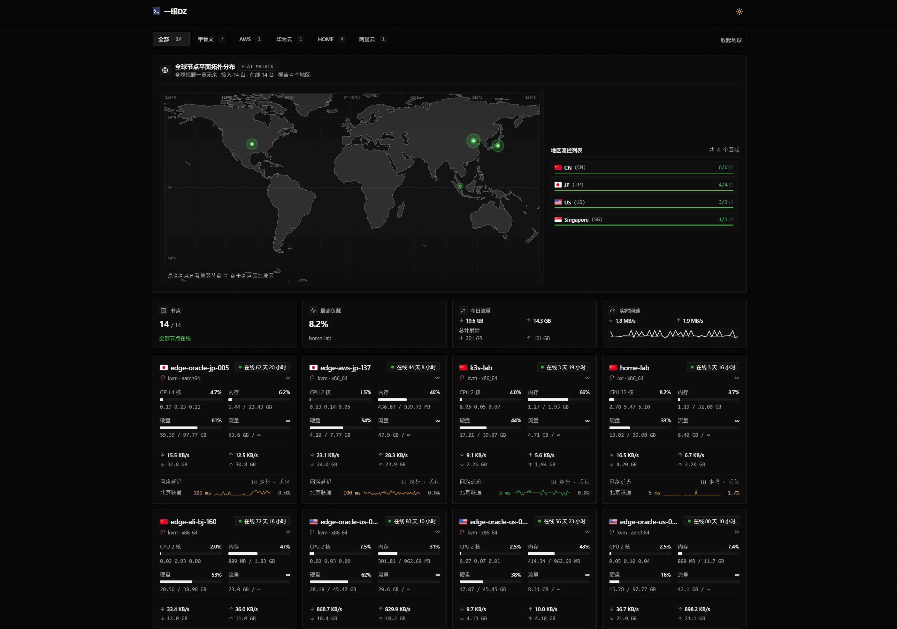

# monitor-theme-default (Enhanced)

> 本仓库 fork 自 [kiusnax/monitor-theme-yydz](https://github.com/kiusnax/monitor-theme-yydz)，在其基础上调整界面，原作者版权见 [LICENSE](LICENSE)。带假数据的本地预览见 [MOCK.md](MOCK.md)。

> 本项目基于 [monitor](https://github.com/monitor-probe/monitor) 官方内置默认主题深度修改与重构而来。在延续轻量、高性能、纯静态 SPA 与黑白极简纯粹质感的同时，全面升级为**精密微倒角工业仪器风**，并针对多节点展示、深度资源遥测与网络质量洞察进行了多项功能增强与体验修复。



---

## 🌟 核心特性与新增功能

### 1. 全球节点分布地图（动态聚合与交互）
- **多节点地区智能聚合**：同一国家/地区合并为单个独立光点展示，光点亮度随该区域活跃节点数量自适应动态增强，避免节点重叠。
- **悬浮节点状态卡片**：鼠标悬停在光点上即弹出高层级微倒角卡片，实时列出该区域所有节点的物理主机名与绿色在线呼吸指示灯。
- **视口防遮挡渲染**：解除外部地图容器的剪裁限制，优化弹窗 z-index 层级，确保边缘地区（如东亚、美洲等）节点弹窗绝不被相邻面板遮挡。

### 2. 首页网络延迟卡片与后台可配置项
- **实时延迟数据卡片**：节点卡片中支持直接展示关键探测目标的网络延迟（Ping/TCP Ping）数据。
- **后台灵活配置（`ping_lines`）**：支持在管理后台直接配置首页卡片展示的探测条目，满足不同站长对主干网络监控的定制诉求。
- **离线节点排版策略（`offline_placement`）**：后台新增离线节点排版控制，支持三种视图呈现：
  1. **默认显示**：保持原有顺序自然混排；
  2. **全部置后**：在线节点排在前面，离线节点统一沉底；
  3. **分区分隔显示**：在线与离线节点独立分块，中间配有微倒角工控离线状态指示栏与数量统计。

### 3. 节点监控详情页深度重构
- **工控规格与实时遥测矩阵**：
  - 重新梳理顶部硬件规格（CPU 架构/型号、内核版本、公网/内网标识）与运行状态。
  - 重构在线时长、系统负载（1/5/15m）与网络实时吞吐（上下行带宽及实时速率），采用状态胶囊与工业仪器级微倒角排版。
- **多维资源占比与热力图分析**：
  - 在原有折线图基础上，新增 CPU、内存、交换分区（Swap）与磁盘挂载的**多维使用占比图**与**环形分布饼图**。
  - 新增 **时段负荷活动热力矩阵（Activity Heatmap）**，直观洞察系统在 24 小时各时间段的高峰活跃周期与资源使用习惯。
- **网络延迟驾驶舱**：
  - 告别单调的大屏单线图，提供全维度延迟与网络质量分析；
  - 集成 RTT 均值、峰值、抖动（Jitter）及丢包率（Packet Loss）关键质量看板；
  - 适配深浅色模式的时间跨度选择器（1小时 / 24小时 / 7天 / 30天），界面质感浑然一体。

### 4. 品牌与交互体验优化
- **矢量化品牌 Logo**：左上角站点 Logo 替换为专有矢量图标 `/favicon.svg`，呈现精致工控质感。
- **访客/管理员入口智能识别**：未登录时对公众访客彻底隐去登录按钮，界面极简无干扰；仅在检测到已登录身份（`me.authed`）时优雅展示“进入后台”入口。
- **微倒角与呼吸动效**：严格遵循 2px 微倒角规范，搭配平滑淡入（fade-in）与节点在线呼吸辉光（pulse-online）。

---

## 🛠️ 问题修复与体验改进（Bug Fixes & Polish）

1. **字体渲染与极小字号清晰度修复**：
   - 全面升级全局字体族，针对 9px / 10px / 11px 等微型数据指标与标签文字进行了字重、字距与平滑度调优。
   - 彻底修复深色模式下微型汉字笔画发虚、黏连和对比度偏暗的问题，确保工控数据一目了然。
2. **WebSocket 实时刷新布局防抖**：
   - 针对顶部“在线时间 / 系统负载 / 实时网络”三大指标卡片，采用定宽网格与 `tabular-nums` 等宽字体布局，彻底消除每 2 秒数据刷新时产生的元素抖动与折行颠簸。
   - 修复时段负荷活动热力矩阵鼠标悬停时底部详情信息显隐引起的容器高度抖动，预置防抖占位，操作丝滑平稳。
3. **图表悬浮弹窗遮挡与文字配色修复**：
   - 修复多维饼图在部分切片角度下 Tooltip 提示框被相邻图表遮挡的问题。
   - 修复饼图深浅两个维度下 Tooltip 文字对比度不足的问题，确保偏暗维度中的数值与说明同样清晰可读。
4. **历史时间窗口（7天 / 30天）跨度计算修复**：
   - 修复节点详情页在切换至 7天 / 30天 跨度时，当节点实际运行天数不足时引发的跨度对齐漂移与指标计算错误；
   - 统一热力图时间桶聚合逻辑，保证跨度时间轴严谨准确。

---

## 💻 开发指南

主题仅读取 hub 提供的公开 API 与 WebSocket 数据，开发时可直接指定任意现成 hub 作为数据源：

```bash
npm install
# Vite 将 /api 与 WebSocket 代理至指定的 hub 地址
MONITOR_HUB=https://hub.example.com npm run dev
```

不指定 `MONITOR_HUB` 时，默认代理至 `http://127.0.0.1:9911`。

### 代码检查与构建

提交前运行完整质量检查与构建：

```bash
# 运行单元测试（校验数字格式化、坐标轴刻度、实时指标边界等）
npm test

# 运行代码规范检查（oxlint）
npm run lint

# 生产环境构建打包
npm run build
```

构建产物将输出至 `dist/` 目录。

---

## 📦 主题包安装与部署

可安装的主题包目录结构如下，目录名称需与 `theme.json` 中的 `short` 保持一致：

```text
<themes-dir>/<short>/
├── theme.json
├── preview.png        # 主题预览图
└── dist/
    └── index.html
```

### theme.json 规范

`theme.json` 包含主题基础元信息及后台配置项：

| 字段 | 含义 |
|---|---|
| `name` | 主题显示名称 |
| `short` | 唯一短名称（字母/数字/`-`/`_`），若设为 `default` 则直接覆盖 hub 内置默认主题 |
| `description` | 主题简要介绍 |
| `version` | 主题版本号 |
| `author` | 作者信息 |
| `url` | 源码地址 |
| `config` | 可选数组，声明站长在后台可自定义的主题设置（hub 后台将据此自动渲染表单） |

将打包好的目录复制到 hub 的 `--themes` 指定路径，在管理后台「主题」页面中即可一键无缝切换，无需重启 hub 服务。

---

## 🔌 主题契约与 API 规范

主题为纯静态 SPA，仅依赖下列同源接口：

| 接口 | 用途 |
|---|---|
| `GET /api/me` | 站点名、登录状态、公开页开关、历史数据保留天数 |
| `GET /api/nodes` | 节点列表、实时运行指标与累计网络流量 |
| `GET /api/nodes/{id}/metrics` | 节点历史资源利用率曲线与延迟测试时序数据 |
| `GET /api/ws` | 每 2 秒推送一次节点快照的 WebSocket（支持 `?gzip` 二进制流） |
| `GET /api/themes/{short}/config` | 获取已保存的主题个性化配置 |

### 注意事项与路由说明

- **SPA 客户端路由**：本主题使用 `/node/{id}` 作为节点详情页。hub 内置服务已配置路由回落至 `dist/index.html`。若 hub 前置部署了带有正向路径白名单的 Nginx、Caddy 或 WAF，**请务必将 `/node/*` 路径以及静态资源放行**，避免刷新详情页时遭遇 404/拦截。
- **丢包率计算约定**：整个时序窗口的探测丢包率由 hub 在 `/api/nodes/{id}/metrics` 响应中的 `loss` 字段直接下发，请勿手动计算样本行中的 `loss` 均值（避免因首尾桶残缺或采样密度不同导致均值失真）。

---

## 📄 开源许可

本项目遵循 [MIT License](./LICENSE) 开源协议。
